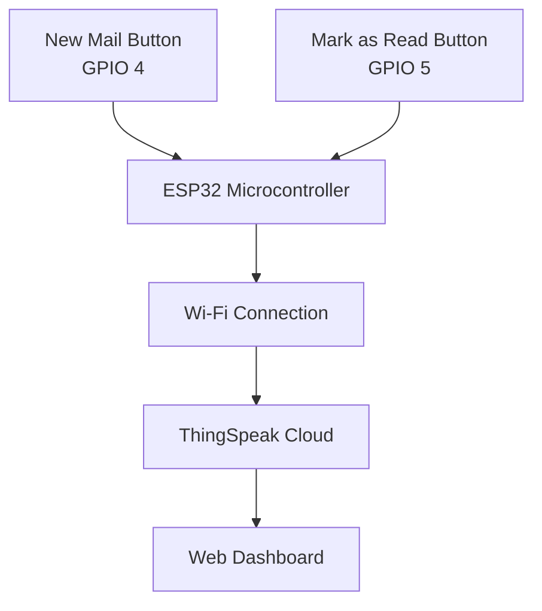

# 📬 Smart Mailbox Notification System using IoT

An IoT-based Smart Mailbox Notification System that detects incoming mail and tracks read and unread messages using an ESP32, Wokwi simulation, ThingSpeak Cloud, and a web dashboard.

## 🌟 Project Overview

The Smart Mailbox Notification System helps monitor incoming mail without manually checking the mailbox. It uses two simulated push buttons to represent mail arrival and mail reading. The ESP32 processes these events and sends updated mail counts to ThingSpeak, where the web dashboard retrieves and displays the information.

## 🎯 Objectives

- Detect and count incoming mail.
- Track unread and read messages.
- Send mailbox data to the cloud using ThingSpeak.
- Display mailbox information through a web dashboard.
- Provide automatic dashboard updates.

## 🛠️ Technologies Used

| Technology | Purpose |
|---|---|
| ESP32 | Main microcontroller |
| Wokwi | ESP32 simulation |
| Arduino C++ | Programming |
| ThingSpeak | Cloud data storage |
| HTML | Dashboard structure |
| CSS | Dashboard design |
| JavaScript | Fetching and displaying cloud data |
| GitHub Pages | Dashboard hosting |

## ⚙️ System Architecture

**Push Buttons → ESP32 → Wi-Fi → ThingSpeak Cloud → Web Dashboard**

1. The New Mail button simulates the arrival of a new message.
2. The ESP32 increases the total and unread mail counters.
3. The Mark as Read button decreases the unread count.
4. The ESP32 uploads the updated values to ThingSpeak.
5. The dashboard retrieves and displays the latest cloud data.

## 🔌 Button Connections

| Component | ESP32 GPIO | Connection |
|---|---:|---|
| New Mail Button | GPIO 4 | Button connected to GND |
| Mark as Read Button | GPIO 5 | Button connected to GND |

Both buttons use the ESP32's internal `INPUT_PULLUP` configuration.

### System Architecture Diagram

## ☁️ ThingSpeak Configuration

**Channel ID:** `3549905`

| ThingSpeak Field | Data |
|---|---|
| Field 1 | Total Mail |
| Field 2 | Unread Mail |
| Field 3 | Read Mail |

The ESP32 sends data to ThingSpeak using its Write API Key. The dashboard reads channel data using the Read API Key.

## 📊 Web Dashboard

The dashboard displays:

- Total Mail
- Unread Mail
- Read Mail
- Mailbox monitoring status
- Last updated time
- Manual refresh option
- Automatic refresh every 20 seconds

🌐 **Live Dashboard:**  
https://divyarane-it.github.io/Smart-Mailbox-IoT-System/

## 🧪 Testing

The system was tested using the Wokwi ESP32 simulation.

| Test | Expected Result |
|---|---|
| System startup | All counters start at zero |
| Press New Mail | Total Mail and Unread Mail increase |
| Press Mark as Read | Unread Mail decreases and Read Mail increases |
| ThingSpeak upload | Updated values appear in the cloud |
| Dashboard refresh | Latest values are displayed |

## 🚀 Future Enhancements

- Add a physical mailbox installation.
- Integrate a physical mail detection sensor.
- Add email or mobile notifications.
- Improve dashboard analytics and mail history.
- Deploy the system using a physical ESP32.

## 👩‍💻 Developer

**Divya Dinesh Rane**  
B.Sc. Information Technology Student

GitHub: https://github.com/divyarane-it

---

*Developed as an IoT academic case study project.*
